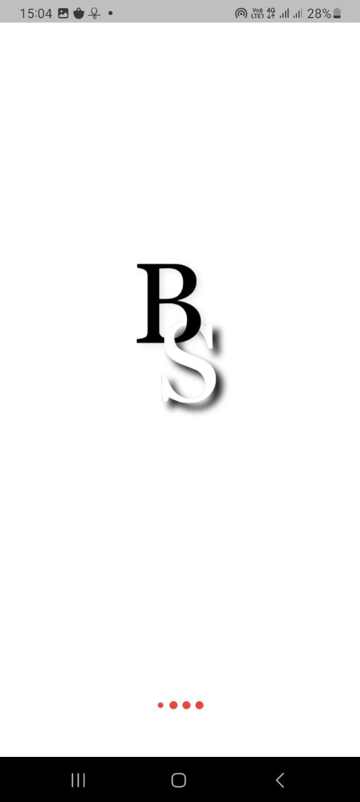
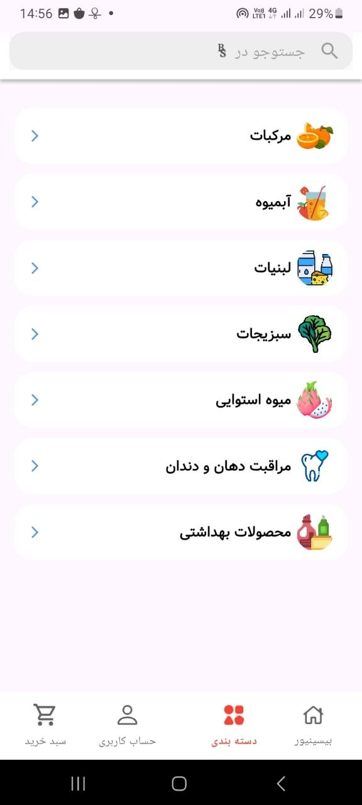
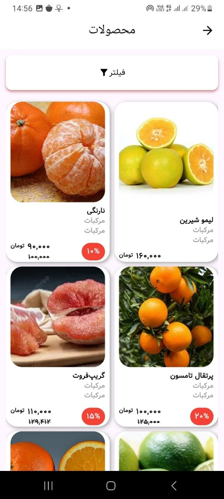
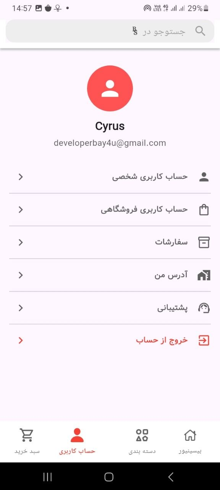

# 🛒 Shopping App

A Flutter e-commerce app for a Persian fruit and grocery store, with a **Supabase** backend, **Bloc/Cubit** state management and passwordless authentication.

Originally started as a course exercise. After the course's backend went offline, I **rebuilt the whole backend myself on Supabase** (database schema, RPC functions, storage and authentication) and migrated the app from a REST API to Supabase.

## 📸 Screenshots

| Splash | Intro | Home |
|:---:|:---:|:---:|
|  |  |  |

| Categories | Products | Profile |
|:---:|:---:|:---:|
|  |  |  |

## ✨ Features

- **Splash and intro screens** shown on first launch
- **Home screen** with an auto-sliding banner carousel, special offers and organic product sections, all loaded from the backend
- **Category tree** with all store categories. Tapping a category opens its products
- **Product listing** with a grid layout, shimmer loading placeholders and cached images
- **Passwordless authentication** with two options:
  - Email one-time code (6-digit OTP)
  - Google sign-in (native on Android, browser OAuth on Web)
- **Persian localization** with RTL layout and Persian numerals
- **Connectivity handling** for offline states
- **Platforms:** Android and Web

## 🧱 Tech Stack

| Area | Packages |
|---|---|
| State management | `flutter_bloc`, `bloc` |
| Dependency injection | `get_it` |
| Backend | `supabase_flutter` (Postgres, Auth, Storage, RPC) |
| Authentication | `google_sign_in`, Supabase Email OTP |
| Networking | `dio`, `connectivity_plus` |
| Local storage | `shared_preferences` |
| UI | `shimmer`, `loading_animation_widget`, `smooth_page_indicator`, `delayed_widget`, `cached_network_image`, `flutter_svg`, `font_awesome_flutter`, `badges`, `flutter_typeahead`, `flutter_rating_bar` |
| Localization | `flutter_localizations`, `intl`, `persian_number_utility` |
| Utilities | `logger`, `location` |

## 🏗️ Architecture

The project uses a **feature-first structure** with a clear separation between data, domain logic and UI:

```
lib/
├── common/          # Shared widgets, utilities, helpers
├── config/          # App configuration and theme
├── features/
│   ├── feature_intro/
│   ├── feature_home/
│   ├── feature_product/
│   └── feature_auth/
│       ├── data_source/    # API providers (Supabase calls)
│       ├── models/         # Data models
│       ├── repositories/   # Error handling, data mapping
│       └── cubit | bloc/   # State management
├── locator.dart     # get_it dependency registration
└── main.dart
```

**Data flow:** `Screen → Cubit/Bloc → Repository → ApiProvider → Supabase`

- **Repositories** catch backend exceptions and return a unified `DataSuccess` / `DataFailed` result, so the UI never deals with raw errors.
- **Dependency injection** with `get_it` keeps providers, repositories and blocs decoupled and easy to test.

## ☁️ Backend (Supabase)

The backend is a **private Supabase project** that I designed and built myself:

- **Database:** a dedicated `shopping` Postgres schema with tables for categories, products, banners and home sections
- **RPC functions:** server-side SQL functions (for example `get_home` and `get_categories_tree`) that return JSON in the shape the app expects, so each screen needs only one request
- **Storage:** a public bucket for product, banner and category images. The database stores image paths and the app builds the public URLs
- **Authentication:** Email OTP via custom SMTP, plus Google OAuth (native ID-token flow on Android, browser redirect on Web)
- **Security:** API keys are not committed. They are injected at build time with `--dart-define-from-file`

> Because the backend is private, the app cannot be run as-is without connecting your own Supabase project.

## 🚀 Getting Started

**Requirements:** Flutter 3.38+ (Dart `^3.10.1`)

```bash
git clone https://github.com/cyrus4u/shopping.git
cd shopping
flutter pub get
```

Create an `env.json` file in the project root (it is listed in `.gitignore`):

```json
{
  "SUPABASE_URL": "https://your-project.supabase.co",
  "SUPABASE_ANON_KEY": "your-anon-key"
}
```

Run the app:

```bash
# Web
flutter run -d chrome --dart-define-from-file=env.json

# Android
flutter run --dart-define-from-file=env.json
```

## 📚 What I Learned

- Designing a Postgres schema and writing RPC functions to replace a REST API
- Migrating an existing app between backends without rewriting the UI layer
- Implementing passwordless auth: Email OTP and Google OAuth on both mobile and web
- Structuring a Flutter app with feature-first architecture, Bloc/Cubit and dependency injection
- Building RTL, Persian-localized interfaces

## 👤 Author

**Cyrus**, Flutter developer
GitHub: [@cyrus4u](https://github.com/cyrus4u)
